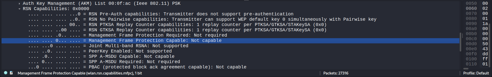
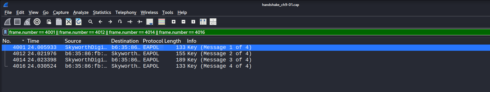
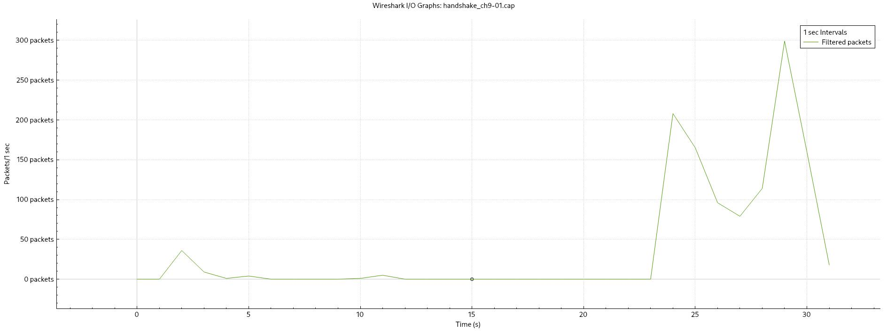

# WPA2 Wireless Security Assessment

## Project Overview

This project documents a security assessment I performed on my own WPA2 wireless network using Kali Linux.

The assessment focused on examining the network's security configuration, testing its resistance to deauthentication attacks, capturing and analyzing the WPA2 four-way handshake, and demonstrating offline password recovery using GPU acceleration.

I also examined encrypted wireless traffic in Wireshark to understand what information remains visible without access to the encryption keys.

All active testing was conducted against my own router and test device.

## Objectives

- Examine the network's WPA2 configuration and Protected Management Frame (PMF) capabilities.
- Test whether forged deauthentication frames can disrupt an authorized client connection.
- Capture and analyze the WPA2 four-way handshake.
- Demonstrate offline dictionary-based password verification using Hashcat.
- Compare pairwise and group encryption in WPA2-CCMP.
- Analyze the metadata visible in encrypted wireless traffic.

## Testing Environment

| Component | Details |
|---|---|
| Operating System | Kali Linux |
| Wireless Adapter | Intel Wi-Fi adapter (monitor mode) |
| GPU | NVIDIA GeForce RTX 4050 Laptop GPU |
| Wireless Security | WPA2-Personal (PSK) |
| Encryption | CCMP |
| Primary Test Band | 2.4 GHz, Channel 9 |
| Test Client | Personal smartphone |

## Tools Used

- **Aircrack-ng Suite:** Wireless monitoring, packet capture and controlled deauthentication testing
- **Wireshark:** Packet inspection and traffic analysis
- **hcxtools:** WPA2 handshake conversion
- **Hashcat:** GPU-accelerated offline password testing

## Testing Methodology

### 1. Wireless Network Reconnaissance

I used Airodump-ng to identify my wireless network and examine its security configuration.

The assessment was conducted on the 2.4 GHz network operating on channel 9, using WPA2-PSK with CCMP encryption.

I then examined the access point's beacon frames in Wireshark to check its Protected Management Frame (PMF) capabilities.

### 2. Deauthentication Testing and Handshake Capture

After confirming that the access point did not advertise PMF capability in the tested configuration, I performed a controlled deauthentication test against my own smartphone.

Using Aireplay-ng, I transmitted one targeted deauthentication burst while Airodump-ng monitored the network.

The phone disconnected and subsequently reconnected. During the reconnection, I successfully captured the WPA2 four-way handshake.

I examined the capture in Wireshark and identified all four EAPOL-Key messages.

### 3. Offline Password Recovery

I converted the captured WPA2 handshake into Hashcat's HC22000 format using `hcxpcapngtool`.

I then used Hashcat with GPU acceleration and a prepared RockYou-based dictionary to demonstrate offline WPA2 password verification.

The test was performed locally using an NVIDIA RTX 4050 Laptop GPU, without sending additional authentication requests to the router.

### 4. WPA2 Encryption and Traffic Analysis

I examined protected 802.11 Data frames in Wireshark to understand how WPA2-CCMP handles different types of traffic.

I compared unicast and broadcast frames, including their destination addresses and CCMP Key Index values.

I also tested whether Wireshark could decode IP packets inside protected frames without the required decryption keys.

Finally, I used Wireshark's I/O Graphs to examine packet rates and traffic patterns that remained observable despite wireless encryption.

## Results and Evidence

### 1. WPA2 Security Configuration

The access point was configured to use WPA2-PSK with CCMP encryption.

While examining its beacon frames in Wireshark, I found that the access point did not advertise Protected Management Frame (PMF) capability in the tested configuration.

The RSN Capabilities showed:

- **MFPC:** 0 (Not Capable)
- **MFPR:** 0 (Not Required)

I had previously observed the same configuration on the router's 5 GHz network.

The absence of PMF means that connected devices do not benefit from its protection against forged deauthentication and disassociation frames.

A detailed explanation of this finding, including its security impact and recommendations, is available in [Security Findings](notes/findings.md).

### 2. Deauthentication and Handshake Capture

I performed a targeted deauthentication test against my own smartphone while monitoring the access point using Airodump-ng.

**Results:**

- Deauthentication bursts transmitted: 1
- Client disconnection: Successful
- Client reconnection: Successful
- WPA2 four-way handshake: Captured successfully

The capture was examined in Wireshark, where I identified all four EAPOL-Key messages.

The capture also contained multiple retransmissions of Message 1 before the client responded. Further analysis of these retransmissions was outside the scope of this experiment.

The test demonstrated that a forged deauthentication attempt could disrupt the connection of the tested client and trigger a new WPA2 handshake.

### 3. Offline WPA2 Password Recovery

I used `hcxpcapngtool` to extract the captured handshake information into Hashcat's HC22000 format.

Hashcat was then used to perform an offline dictionary attack with GPU acceleration.

**Results:**

| Metric | Result |
|---|---|
| Tool | Hashcat v7.1.2 |
| GPU | NVIDIA RTX 4050 Laptop GPU |
| Attack Mode | Straight Dictionary Attack |
| Hash Mode | 22000 |
| Wordlist | RockYou-based test dictionary |
| Candidate progress, including rejected candidates | 14,344,386 / 14,344,386 |
| Rejected Candidates | 4,734,913 |
| Reported testing speed at completion | 234.8 kH/s |
| Attack Runtime | Approximately 41 seconds |
| Password Recovery | Successful |

The test demonstrated how password candidates can be verified against a captured WPA2 handshake without further communication with the access point.

The experiment used a prepared dictionary containing the test credential. The successful result therefore demonstrates offline verification rather than independent discovery of an unknown password.

### 4. WPA2 Encryption and Traffic Analysis

I examined protected 802.11 Data frames in Wireshark to compare pairwise and group encryption.

**Observed results:**

| Property | Unicast Traffic | Broadcast Traffic |
|---|---|---|
| Example Packet | #82 | #34 |
| Destination | Individual client | Broadcast address |
| CCMP Key Index | 0 | 1 |
| Key Type | Pairwise Temporal Key | Group Temporal Key |
| Protected Frame | Yes | Yes |

I also applied a display filter combining protected 802.11 Data frames with the IP protocol.

Wireshark returned **0 matching packets** for that filter in this capture. This is consistent with the protected payloads remaining undecoded in that session. The filter result alone does not establish whether those payloads contained IP traffic.

Finally, I examined the traffic using Wireshark's I/O Graphs.

The graph showed relatively little activity during the early part of the capture, followed by noticeable increases in packet volume after the client's reconnection.

The highest observed rate was approximately **300 packets per second**.

Although WPA2-CCMP protects the contents of wireless data frames, information such as MAC addresses, frame sizes, packet timing and traffic volume remains observable.

#### Encrypted Traffic Analysis — Wireshark I/O Graph

The graph shows the packet rate of protected 802.11 Data frames involving the test client, measured at one-second intervals.

## Conclusion

This assessment helped me examine WPA2 security beyond its basic authentication and encryption mechanisms.

The main security concern identified was the absence of PMF capability in the tested configuration. During controlled testing, a targeted deauthentication attempt successfully disconnected my test device, allowing me to capture and analyze a new WPA2 four-way handshake.

I also demonstrated offline password verification using Hashcat and examined how WPA2-CCMP protects wireless traffic. While the encrypted payloads could not be decoded without the necessary keys, information such as MAC addresses, packet sizes and transmission patterns remained visible.

Overall, the project demonstrated how wireless security depends on more than encryption alone. Management-frame protection, password strength and network configuration also play important roles.

## Limitations

- The assessment was conducted on a single home router and personal test device.
- Deauthentication testing was limited to a controlled experiment, so the results may differ with other devices and network configurations.
- The offline dictionary experiment used a prepared wordlist containing the test credential.
- The traffic analysis focused on observable wireless metadata rather than decrypting application traffic.
- The assessment did not cover WPA3-SAE, enterprise authentication or other wireless security configurations.

## Security Recommendations

Based on the assessment, the following measures are recommended:

- Enable PMF where supported, preferably in Required mode when compatible with connected devices.
- Use a strong, unique Wi-Fi passphrase to reduce the effectiveness of offline password-guessing attacks.
- Consider WPA3-Personal where supported.
- Keep router firmware updated and periodically review wireless security settings.

